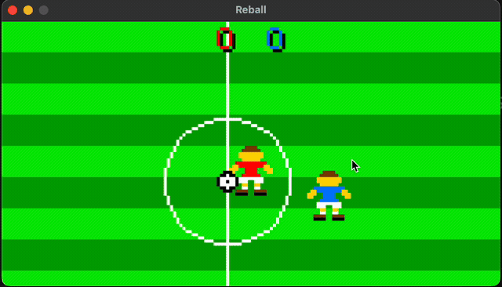

# 16-Bit Custom CPU, Assembler & Emulator

A custom 16-bit processor architecture built from scratch, featuring a two-pass assembler, an SDL2-based emulator, and **Reball**—a full 2D retro football game written in ~4,000 lines of pure assembly to stress-test the hardware design.



---

## Architecture Overview

The system uses a 16-bit Harvard architecture with separate instruction and data memory buses, each addressing up to 64K 16-bit words.

### Registers
There are 16 registers (16-bit each):
- `R0 - RB`: General-purpose registers (`R0` is typically treated as 0 in conventions).
- `RC` / `SR`: Status register (Condition flags: `Z`, `C`, `N`, `V`, `I`).
- `RD` / `LR`: Link register (holds return address for `CALL` / `RET`).
- `RE` / `SP`: Stack pointer (initialized to `0xFEFF`, grows downwards).
- `RF` / `PC`: Program counter (starts execution at `0x0000`).

### Condition Flags
- **Z (Zero)**: Set if operation result is zero.
- **C (Carry)**: Set on arithmetic carry/borrow or shift out.
- **N (Negative)**: Set if bit 15 of result is 1.
- **V (Overflow)**: Set on signed arithmetic overflow.
- **I (Interrupt)**: Interrupt enable mask.

### Instruction Encoding
All instructions are a single 16-bit word divided into four formats:
- **R-Type** `[Op:4][Dest:4][Src1:4][Src2:4]`: Register arithmetic (`ADD`, `SUB`, `AND`, `OR`, `XOR`, `LSL`, `LSR`).
- **I-Type** `[Op:4][Dest:4][Immediate:8]`: Constants (`LOADI`, `LOADHI`).
- **J-Type** `[Op:4][Offset:12]`: Jumps (`JMP`, `JEQ`, `JNE`).
- **S-Type** `[Op:4][SubOp:4][Reg:4][Unused:4]`: System operations (`NOP`, `PUSH`, `POP`, `CALL`, `RET`, `HALT`).

### Memory Map (64K Words)
```
0x0000 - 0x351F   VRAM (160x85 native frame buffer, 13,600 pixels)
0x3520 - 0xFEFF   General-purpose RAM (variables grow up, stack grows down)
0xFF00            MMIO: Terminal stdout character output
0xFF01            MMIO: Gamepad input bitmask (WASD + K, L, P)
0xFF02            MMIO: VBlank / frame sync latch
```

---

## The Game Test: Reball

Rather than relying on basic synthetic microbenchmarks, **Reball** (`reball.asm`) was built as a full game test to push the architecture, instruction set, assembler, and emulator to their limits.

Writing a complete ~4,000-line game directly in raw assembly verified several critical systems under realistic load:

- **VRAM Rasterization**: Software rendering across a 640x340 virtual pitch mapped through a dynamic 160x85 camera viewport. Tests midpoint circle algorithms (center circle), vertical/horizontal lines (penalty boxes, touchlines), and custom 4-bit packed sprite decoders with dynamic palette swaps (jersey colors).
- **Subroutine Call Stacks**: Deeply nested routines (`draw_loop` -> `draw_pitch` -> `draw_players` -> `draw_sprite`) testing register preservation (`PUSH` / `POP`) and `LR` handling without corrupting return addresses.
- **Arithmetic & Flag Precision**: Fixed-point camera smoothing, distance checks, directional velocity updates, and boundary clipping relying on exact `FLAG_N` and `FLAG_Z` masking after `CMP` and `SUB`.
- **Entity Simulation & State Logic**: Managing positions, collision checks, tackle cooldowns, and restart states (kickoffs, throw-ins, corners, goal detection, digit font rendering) for 22 simultaneous players and a loose ball.

---

## Controls

The emulator maps SDL keyboard events into the 16-bit input register at `0xFF01`:

| Key | Action |
| --- | --- |
| `W` / `A` / `S` / `D` | Move player / Aim pass or shot |
| `K` | Pass ball |
| `L` | Shoot on goal |
| `P` | Switch to closest outfield teammate |

---

## Building & Running

### Requirements
- GCC or Clang
- SDL2 (`brew install sdl2` on macOS, or `apt install libsdl2-dev` on Linux)

### 1. Compile the Tools
```bash
# Compile the custom two-pass assembler
gcc -O2 assembler.c -o assembler

# Compile the CPU emulator (SDL2 frontend)
gcc -O2 main.c $(sdl2-config --cflags --libs) -o emulator
```

### 2. Assemble Reball
```bash
./assembler reball.asm
```
This produces `out.bin` containing instruction memory words and initial data definitions.

### 3. Run the Game
```bash
./emulator out.bin
```

---

## Project Structure
- `16bit.txt`: Formal CPU architecture specification and opcode reference.
- `assembler.c`: Two-pass symbol-resolving assembler.
- `main.c`: C emulator implementing the CPU instruction decode loop and SDL2 video/input frontend.
- `reball.asm`: The complete football game implementation written in assembly.
- `test.asm`: Minimal "Hello World" sanity check for testing basic console output MMIO.

